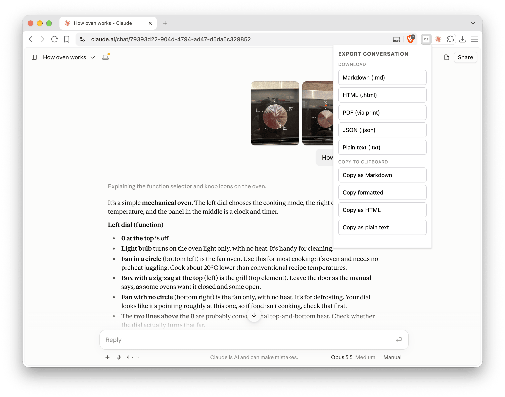

# Claude Exporter

> A privacy-first Chrome extension to export [claude.ai](https://claude.ai) conversations to **Markdown**, **HTML**, **PDF**, **JSON** and **plain text** — or copy them straight to your **clipboard**.

[](https://chromewebstore.google.com/detail/claude-exporter/hebhnhibdecijopliikejmojkpkcelbc)
[](./LICENSE)
[](https://developer.chrome.com/docs/extensions/mv3/intro/)
[](./tsconfig.json)

Everything runs locally in your browser. No backend, no telemetry, no third-party services. Audit the entire codebase in an afternoon.

<p align="center">
  
</p>

---

## Features

- **Export to Markdown** — clean `.md` with human/assistant turns, code blocks, and collapsible thinking sections.
- **Export to HTML** — self-contained, single-file `.html` with inlined styles. Claude's replies are rendered from Markdown (headings, lists, tables, code blocks), as on claude.ai.
- **Export to PDF** — opens a print-tuned preview and triggers your browser's native print dialog (vector text, real pagination).
- **Export to JSON** — the whole conversation as structured data, for scripts and other tools (see [Architecture](#architecture)).
- **Export to plain text** — `.txt` with no Markdown or HTML around the messages, for email, tickets and anywhere Markdown would show as clutter. Message text is kept exactly as written.
- **Copy to clipboard** — copy as Markdown, as HTML source, as plain text, or **formatted**, which pastes into Google Docs, Notion and similar with headings, lists and code intact.
- **Branched conversations** — only the active branch (the path you're reading) is exported, not regenerated dead-ends.
- **Artifacts** — exported in full, with later edits applied, so each one shows the version Claude produced at that point (labelled v2, v3, …).
- **Images** — embedded in HTML, PDF and formatted copies (claude.ai's ~1000px preview), so the file stands alone. Markdown, plain text and JSON link to the preview instead; those links only open while you're logged in to claude.ai.
- **Attachments** — text claude.ai extracted from pasted or uploaded documents is included (collapsed); other files are listed by name.
- **Timestamps** — each turn shows when it was sent (UTC) in Markdown, HTML and PDF.
- **Thinking** — Claude's thinking, or its summary where claude.ai only kept a summary, in collapsible sections.
- **Multiple organizations** — works whether the conversation lives in your personal account or a Team/Enterprise org.
- **Code-fence safe** — code blocks containing backticks get a longer fence, so they don't break out.
- **XSS-safe** — raw HTML in conversations is escaped, and `javascript:`-style links are dropped. Images are embedded as data, never loaded from a URL, so opening an export never fetches anything.

## Privacy

This extension is built around one principle: **your conversations never leave your browser**.

- ✅ **Zero network calls outside `claude.ai`.** No analytics, no telemetry, no error reporting, no remote code.
- ✅ **No persistent storage.** Nothing is written to disk other than the files _you_ choose to export.
- ✅ **Minimal permissions** (see [below](#permissions)).
- ✅ **No build-time obfuscation.** Source maps are shipped with the build so you can step through the exact code that runs.
- ✅ **Reproducible builds.** `npm ci && npm run build` from a release tag reproduces the released `dist/` (see [below](#reproducible-builds)).
- ✅ **Open source under MIT.**

### Permissions

| Permission                              | Why we need it                                                                                                                                                                                                                                                                                       |
| --------------------------------------- | ---------------------------------------------------------------------------------------------------------------------------------------------------------------------------------------------------------------------------------------------------------------------------------------------------- |
| `host_permissions: https://claude.ai/*` | Required to inject the content script into your claude.ai tab and call the claude.ai JSON API from that script using your existing session cookies. The extension touches no other origin.                                                                                                           |
| `storage`                               | Used only via `chrome.storage.session` (in-memory, cleared when the browser closes) to hand the rendered print-ready HTML from the popup to the print-preview tab. We never write to `chrome.storage.local` or `sync`, so nothing persists across sessions and nothing syncs to your Google account. |

Permissions we deliberately do **not** request:

- **`activeTab`** — not needed; `host_permissions` for `claude.ai` already lets us read the active tab's URL when it matches.
- **`tabs`** — not needed for the same reason.
- **`downloads`** — `.md` and `.html` exports use a normal anchor click with the `download` attribute, which doesn't require the API.
- **`scripting`** — the content script is registered statically in the manifest; we never inject programmatically.
- **`<all_urls>` / any other host** — the extension only ever talks to `claude.ai`.

## Installation

### Chrome Web Store

Install [Claude Exporter from the Chrome Web Store](https://chromewebstore.google.com/detail/claude-exporter/hebhnhibdecijopliikejmojkpkcelbc).

### From source (unpacked)

```bash
git clone https://github.com/bensquire/claude-exporter.git
cd claude-exporter
nvm use            # Node version from .nvmrc
npm ci
npm run build
```

Then in Chrome:

1. Open `chrome://extensions`.
2. Enable **Developer mode** (top-right toggle).
3. Click **Load unpacked** and select the `dist/` directory.
4. Pin the extension to your toolbar (optional but convenient).

## Usage

1. Open any conversation on [claude.ai](https://claude.ai).
2. Click the **Claude Exporter** icon in your toolbar.
3. Pick an action:
    - **Download**: Markdown · HTML · PDF · JSON · Plain text
    - **Copy to clipboard**: Copy as Markdown · Copy formatted · Copy as HTML · Copy as plain text

For PDF: a new tab opens with the print preview and the system print dialog automatically appears. Choose **Save as PDF** as the destination. Chrome remembers your last destination, so subsequent prints are effectively one click.

If a claude.ai tab was open before you installed the extension, the first export reloads it so the content script can load. Anything you'd typed but not sent in that tab is lost.

### Limitations

- Images are exported at claude.ai's preview size (about 1000px), not as the original upload, which claude.ai doesn't make available. Other files are listed by name; only text claude.ai extracted from documents is exported.
- Chrome caps the data passed to the print tab at 10 MB, so a PDF of a conversation with very many images (roughly 100 or more) fails. HTML export has no such limit.
- Thinking is included in Markdown and HTML exports (collapsed), but hidden in PDFs. When claude.ai only kept a summary of the thinking, the summary is exported, labelled "Thinking (summary)".
- **Copy as HTML** copies the HTML source as text. Use **Copy formatted** to paste formatted text.
- claude.ai's API is undocumented, so a change on their side can break exports until the extension is updated.

## How it works

claude.ai exposes a cookie-authenticated JSON API at `/api/organizations/{org}/chat_conversations/{chat}?tree=True&rendering_mode=messages`. Because the extension's content script runs on the `claude.ai` origin, your browser cookies are sent automatically — no token handling, no OAuth, no storage of credentials. The org is taken from claude.ai's `lastActiveOrg` cookie, falling back to each of your other orgs in turn.

The full message tree is fetched and converted into a **transcript**: the active branch (using `current_leaf_message_uuid`), with each message's content blocks (text, thinking, images, artifacts, tool calls and results) and attachments in a simple, documented shape. Every output format is a pure function of that transcript. For HTML-based formats, image previews are first fetched from claude.ai (with your session, as the page itself does) and embedded.

For PDF specifically: rather than rasterizing the live claude.ai page (which produces poor output because their CSS isn't print-tuned), the extension generates its own standalone HTML with a print-optimized stylesheet, opens it in a new tab, and triggers `window.print()`. Result: vector text, real pagination, and turns kept on one page where they fit.

## Architecture

```
src/
├── manifest.ts              # MV3 manifest, permissions, content_scripts
├── messages.ts              # Typed popup ↔ content script message protocol
├── util.ts                  # safeStringify, shared by the converter and formatters
├── popup/
│   ├── popup.html           # Toolbar popup UI
│   └── popup.ts             # Button handlers, clipboard write, tab opening
├── content/
│   ├── content.ts           # Message handler: fetch, convert, dispatch to a formatter
│   ├── api.ts               # Authenticated fetch wrappers for claude.ai API
│   └── types.ts             # Types for the claude.ai API responses
├── transcript/
│   ├── types.ts             # The Transcript format every formatter consumes
│   ├── from-claude.ts       # claude.ai API → Transcript (the only code that knows the API shape)
│   ├── images.ts            # Embeds image previews, given a fetcher
│   └── options.ts           # Export options and applyOptions (thinking, attachment text)
├── formatters/
│   ├── shared.ts            # Escaping, fence picking, labels, timestamps
│   ├── markdown.ts          # Transcript → Markdown
│   ├── html.ts              # Transcript → standalone HTML + print CSS, or a style-free fragment
│   ├── json.ts              # Transcript → JSON
│   └── text.ts              # Transcript → plain text
└── viewer/
    ├── viewer.html          # Print preview shell
    └── viewer.ts            # Reads HTML from session storage and prints
```

```
claude.ai JSON ──toTranscript──▶ Transcript ──applyOptions──▶ Transcript ──embedImages¹──▶ Transcript ──formatter──▶ .md / .html / .json / .txt / clipboard
```

¹ HTML-based formats only.

The converter and formatters are **pure functions**: no I/O, no DOM, no `chrome.*` APIs. `embedImages` is handed its fetcher, so it's tested without a network. When claude.ai changes its API, only `transcript/from-claude.ts` should need to change.

### The Transcript format

Defined in [`src/transcript/types.ts`](./src/transcript/types.ts), and exported as-is (with a `schema` tag) by the JSON export:

- **Transcript**: `id`, `title`, optional `createdAt` / `updatedAt` / `model`, and `turns`.
- **Turn**: `id`, `role` (`human` | `assistant`), optional `createdAt`, `blocks`, `attachments`.
- **Block**, by `kind`:
    - `text`: with `format` `markdown` (Claude's replies) or `plain` (your messages, shown verbatim);
    - `thinking`: with `summarized` when only a summary was kept;
    - `image`: the file's name, and its claude.ai preview `url` and `width` / `height` when known (`dataUrl` holds the image itself only inside HTML-based exports);
    - `artifact`: the full content at that point, with `version` and `partial` (only an edit was available);
    - `tool_use` (raw `input`), `tool_result`, and `unknown` for block types this version doesn't know.
- **Attachment**: `name`, optional `size` / `mimeType` / `extractedText`, and `source` (`upload` or `file`).

### Adding an output format

1. Add `src/formatters/<name>.ts` exporting `(t: Transcript) => string`.
2. Add the format to `ExportFormat` in `src/messages.ts` and to the `exporters` table in `src/content/content.ts`.
3. Add a button in `src/popup/popup.html`, and tests in `tests/formatters/`.

TypeScript checks that every block kind is handled, so a format can't silently skip one.

## Development

```bash
nvm use                # Node version from .nvmrc
npm ci                 # install dependencies (lockfile-frozen)

npm run dev            # HMR-capable dev build (watch mode)
npm run build          # production build → dist/
npm run typecheck      # tsc --noEmit
npm run lint           # oxlint
npm run format         # oxfmt . (writes in place)
npm run format:check   # oxfmt --check .
npm test               # vitest unit tests
npm run test:watch     # vitest in watch mode
```

After running `npm run build`, **reload the extension** in `chrome://extensions` (the circular arrow icon on the extension card) to pick up your changes.

### Tooling

- **[Vite](https://vitejs.dev)** + **[@crxjs/vite-plugin](https://crxjs.dev/vite-plugin)** — fast builds, HMR, MV3-aware bundling.
- **TypeScript strict mode** with `noUncheckedIndexedAccess` and `exactOptionalPropertyTypes`.
- **[oxlint](https://oxc.rs/docs/guide/usage/linter.html)** + **[oxfmt](https://oxc.rs/docs/guide/usage/formatter.html)** — fast Rust-based linter and formatter.
- **[Vitest](https://vitest.dev)** — unit tests for the formatters, API helpers and edge cases.

### Releasing

Pushing a version tag publishes to the Chrome Web Store via GitHub Actions. See [RELEASING.md](./RELEASING.md).

### Code style

- 4-space indentation, single quotes, semicolons, trailing commas. Enforced by `oxfmt` (see `.oxfmtrc.json`).
- Arrow functions over `function` declarations (personal preference).
- Defensive parsing at the API boundary in `src/content/api.ts` and `src/content/types.ts`. The claude.ai API is undocumented and may change.

### Testing

Unit tests cover:

- Branched conversation trees (only the active branch is rendered).
- HTML escaping (XSS-safe rendering of arbitrary user content), including raw HTML, `javascript:` links and images inside Claude's Markdown.
- Converting claude.ai data into the transcript, including artifact versions, thinking summaries, inline images and attachments.
- Embedding images: only claude.ai URLs are fetched, and only `data:image/…` ever reaches an ``.
- Each output format, including the JSON round trip and the formatted-copy fragment.
- Finding a conversation across multiple organizations (personal + Team/Enterprise).
- Code-fence collision (backticks inside content force the fence to grow).
- Unknown / future block types (degrade gracefully, never crash).
- Empty conversations, single messages, very long conversations (200+ messages).
- Unicode, emoji, RTL text.
- Missing optional fields.

## Reproducible builds

Each [GitHub release](https://github.com/bensquire/claude-exporter/releases) has the exact zip that was uploaded to the Chrome Web Store, built by CI from the tagged commit. To check it against the source:

```bash
git clone https://github.com/bensquire/claude-exporter.git
cd claude-exporter
git checkout vX.Y.Z           # the release tag
nvm use                       # Node version pinned in .nvmrc
npm ci                        # frozen-lockfile install
npm run build
```

`dist/` should match the contents of the release zip byte for byte, except `assets/crx-manifest.js-*.js.map`: that source map embeds a path that depends on where you cloned the repo.

## Contributing

Issues and PRs welcome. Please:

1. Run `npm run typecheck && npm run lint && npm run format:check && npm test` before opening a PR.
2. Add tests for any change to the formatters or content-block walker.
3. Keep the runtime dependency surface minimal — every dep is something users have to audit. The only direct one today is [`markdown-it`](https://github.com/markdown-it/markdown-it), for rendering Claude's replies in HTML exports; it brings in five small packages of its own (`entities`, `linkify-it`, `mdurl`, `punycode.js`, `uc.micro`).
4. Don't add new permissions to the manifest without strong justification.

## License

[MIT](./LICENSE) © Ben Squire
